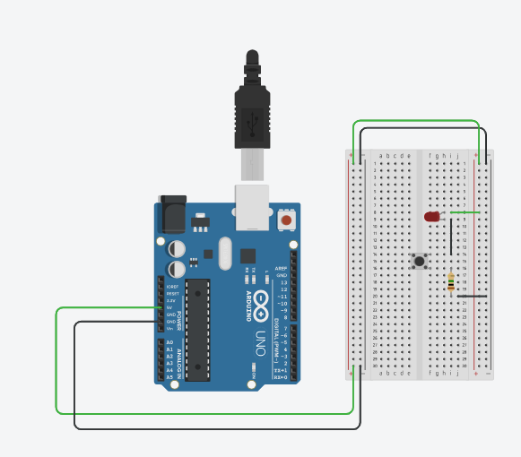

# Practical 7 - Arduino Uno Simulation

## Overview
An Arduino Uno R3 circuit simulation built and tested in Tinkercad.

## Circuit Diagram

## Tinkercad Simulation
[View Circuit on Tinkercad](https://www.tinkercad.com/things/dMGoeTWSaes-26070521304purva-akarepractical-7)
