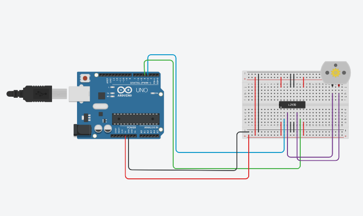

# Practical 8A - Alternating Two-LED Blink

## Overview
An Arduino Uno circuit built in Tinkercad that alternates turning two LEDs on and off (connected to digital pins 3 and 4) every 1 second.

## Circuit Diagram

## Tinkercad Simulation
[View Circuit on Tinkercad](https://www.tinkercad.com/things/bAAc3xWeqQv-prac8-a)
