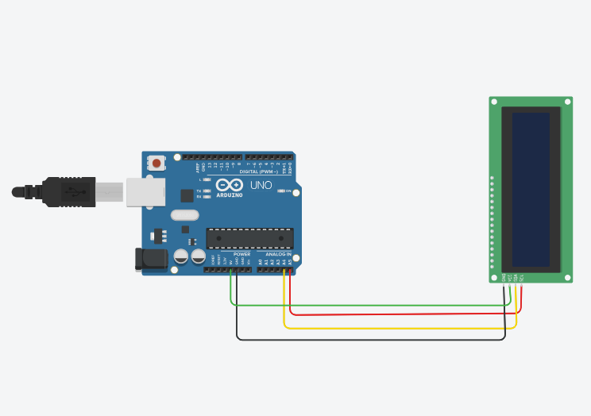

# Practical 8B - I2C LCD Display

## Overview
An Arduino Uno circuit using `LiquidCrystal_I2C` (`lcd_1`) to display `"Purva Akare"` on the top row and `"26070521304"` on the bottom row every 2 seconds before clearing.

## Circuit Diagram

## Tinkercad Simulation
[View Circuit on Tinkercad](8B_TINKERCAD_LINK)
