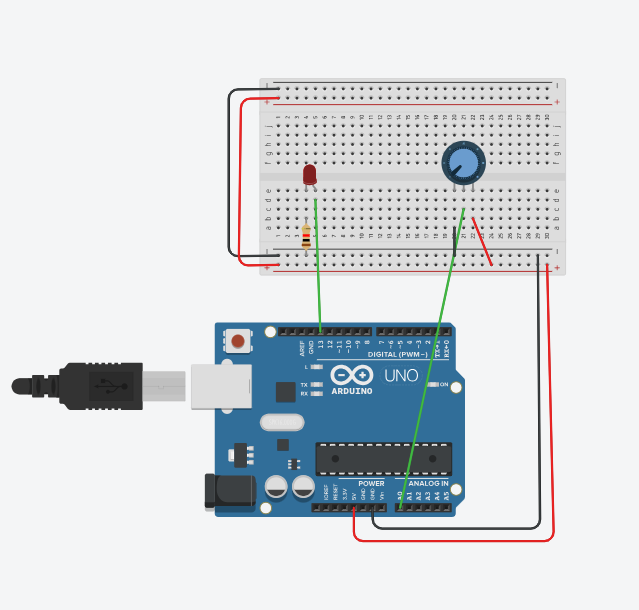

# Practical 8C - Analog Sensor Controlled LED Blink

## Overview
An Arduino Uno circuit that reads an analog input value (`sensorValue`) from pin `A0` and uses it to dynamically control the blink delay of an LED connected to digital pin `13`.

## Circuit Diagram

## Tinkercad Simulation
[View Circuit on Tinkercad](YOUR_8C_TINKERCAD_LINK)
