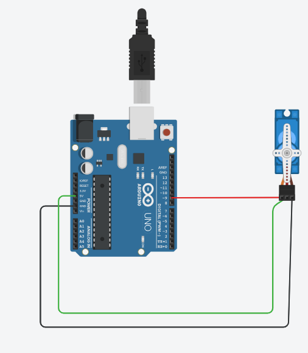

# Practical 8D - Servo Motor Sweep

## Overview
An Arduino Uno circuit using the `Servo` library to sweep a servo motor (connected to digital pin `9`) smoothly from `0°` to `180°` and back to `0°`.

## Circuit Diagram

## Tinkercad Simulation
[View Circuit on Tinkercad](YOUR_8D_TINKERCAD_LINK)
