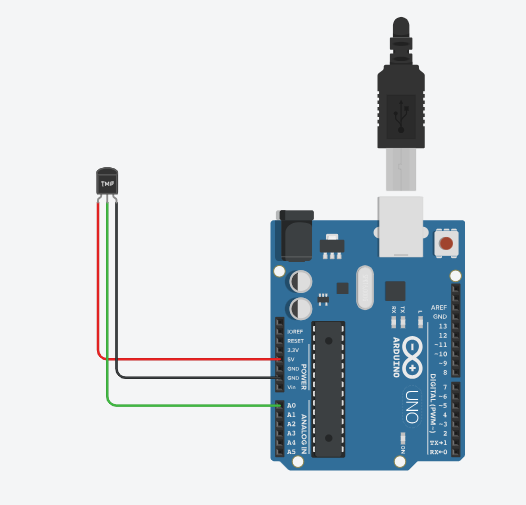

# Practical 8E - Built-in LED Blink

## Overview
An Arduino Uno circuit that blinks the onboard `LED_BUILTIN` (pin `13`) on and off at 1-second intervals.

## Circuit Diagram

## Tinkercad Simulation
[View Circuit on Tinkercad](YOUR_8E_TINKERCAD_LINK)
