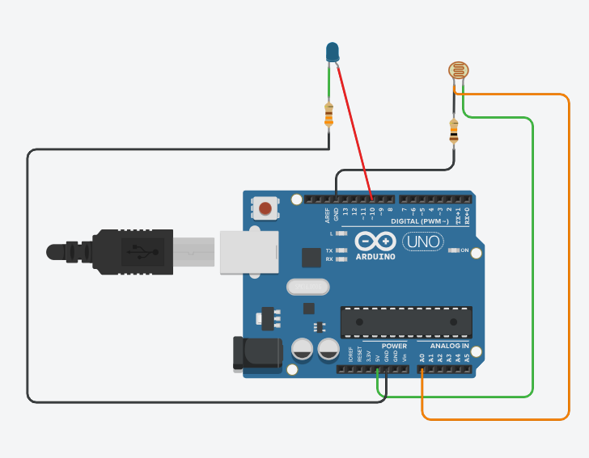

# Practical 9 - LDR Light Sensor Controlled LED

## Overview
An Arduino Uno circuit that reads light intensity (`LDR_VAL`) from a photoresistor (LDR) connected to analog pin `A0` and turns on an LED on digital pin `10` when the sensor value falls between `300` and `500`.

## Circuit Diagram

## Tinkercad Simulation
[View Circuit on Tinkercad](YOUR_9_TINKERCAD_LINK)
